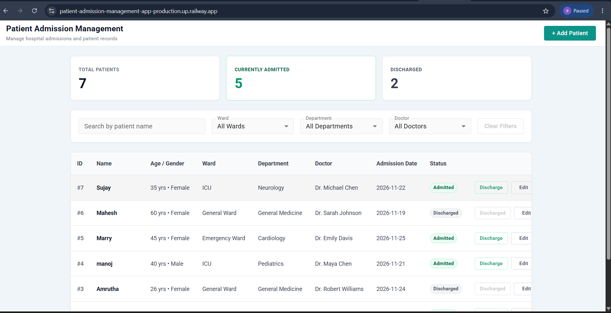

# Patient Admission Management App

A responsive web application designed to simplify hospital patient admissions, manage patient records, and track discharge status.
---

## 1. Tech Stack

- **Frontend**: React.js (Vite), Material UI (MUI), Axios
- **Backend**: Python FastAPI, Pydantic, SQLAlchemy
- **Database**: SQLite (persists across restarts)

---

## 2. Steps to Run Locally

### Prerequisites
- Python 3.9+
- Node.js 20+

### Backend Setup
```bash
cd backend
pip install -r requirements.txt
python -m uvicorn main:app --reload --port 8000
```
- API URL: `http://127.0.0.1:8000`
- Swagger Docs: `http://127.0.0.1:8000/docs`

### Frontend Setup
```bash
cd frontend
npm install --legacy-peer-deps
npm run dev
```
- Web App: `http://localhost:5173`

---

## 3. Features

1. **Add Patient:** Register new patients.
2. **View Patients:** Display all patient records.
3. **Search:** Search patients by name.
4. **Filter:** Filter patients by Ward, Department, and Doctor.
5. **Edit Patient:** Update patient details.
6. **Delete Patient:** Delete records with confirmation.
7. **Discharge Patient:** Mark patients as discharged.
8. **Responsive Design:** Support desktop, tablet, and mobile screens.
9. **Form Validation:** Validate required fields and patient details on frontend and backend.

---

## 4. Validation Rules

- **Name:** Required; letters and spaces only.
- **Age:** Required; integer between 0 and 120.
- **Gender, Ward, Department, Doctor:** Required; select from predefined options.
- **Admission Date:** Required; cannot be a future date.
- **Backend Validation:** Invalid data is rejected with clear error responses.

---

## 5. API Endpoints

| Method | Endpoint | Description |
|---|---|---|
| `GET` | `/options` | Predefined dropdown options |
| `GET` | `/patients` | Get all patients (with search/filter query support) |
| `GET` | `/patients/{id}` | Get single patient by ID |
| `POST` | `/patients` | Create new patient record |
| `PUT` | `/patients/{id}` | Update patient record |
| `DELETE` | `/patients/{id}` | Delete patient record |
| `PATCH` | `/patients/{id}/discharge` | Mark patient as Discharged |

---

## 6. Project Structure

```
Patient-Admission-Management-App/
├── backend/
│   ├── database.py
│   ├── main.py
│   ├── models.py
│   ├── requirements.txt
│   └── schemas.py
├── frontend/
│   ├── src/
│   │   ├── components/
│   │   │   ├── ConfirmDialog.jsx
│   │   │   ├── PatientFilters.jsx
│   │   │   ├── PatientForm.jsx
│   │   │   └── PatientTable.jsx
│   │   ├── services/
│   │   │   └── patientService.js
│   │   ├── App.jsx
│   │   ├── index.css
│   │   └── main.jsx
│   ├── index.html
│   ├── package.json
│   └── vite.config.js
├── .gitignore
└── README.md
```

---

## 7. Live Links

-## 7. Live Links

- **Frontend: https://patient-admission-management-app-production.up.railway.app
- **Backend API: https://patient-admission-management-app-production-e83b2826.up.railway.app
- **API Documentation: https://patient-admission-management-app-production-e83b2826.up.railway.app/docs

---

## 8. Screenshots

1.Dashboard 
**

2. New patient form
**

3.Filter by department
**

4.Filter by ward
**


